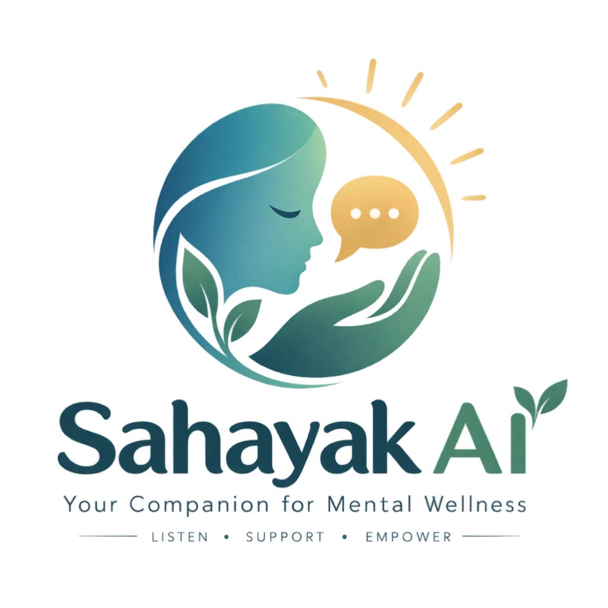
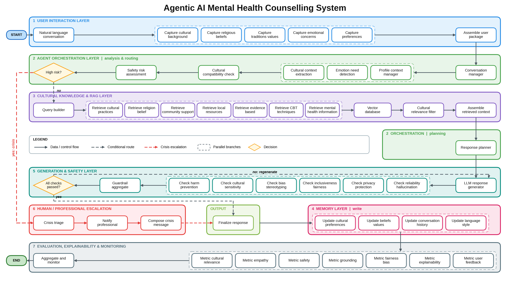

<div align="center">



# SAHAYAK AI
### A Culturally-Adaptive, Privacy-Preserving Agentic AI Mental Health Companion

[](https://www.python.org/)
[](https://github.com/langchain-ai/langgraph)
[-black?logo=ollama&logoColor=white)](https://ollama.com/)
[](https://www.trychroma.com/)
[](https://streamlit.io/)
[](#-why-sahayak-ai)

*Listen · Support · Empower*

</div>

---

## About SAHAYAK AI

**SAHAYAK AI** (*"Sahayak"* meaning *Helper* or *Companion* in Sanskrit and Hindi) is an open-source, culturally-grounded mental health companion built as a **Compound Agentic AI System** using **LangGraph StateGraph**. 

Unlike monolithic LLM wrappers or simple conversational chatbots, SAHAYAK AI operates as a **coordinated multi-agent cognitive network** where specialized sub-agents perform sensory intake, clinical risk assessment, domain-routed retrieval, stateful memory persistence, and iterative self-reflection before delivering any response.

### Core Capabilities:
1. **Dual-Framework Cognitive Healing**: Unifies evidence-based psychological modalities (**CBT**, **ACT**, **DBT**, Mindfulness) with culturally resonant philosophical frameworks (e.g., **Bhagavad Gita** concepts of *Karma Yoga*, detachment from outcomes, duty, emotional equanimity, and collectivist family coping).
2. **Clinical Exemplar Grounding**: Employs an agentic retrieval tool over **24 curated psychiatric exemplar demonstrations**, structuring outputs into a proven 4-stage therapeutic sequence:
   $$\text{Emotional Validation} \longrightarrow \text{Cognitive Reframing} \longrightarrow \text{Actionable Coping Strategy} \longrightarrow \text{Philosophical / Cultural Grounding}$$
3. **Actor-Critic Guardrails with Self-Correction**: Implements an iterative reflection loop where six independent critic nodes evaluate the draft for harm, cultural bias, stereotyping, and hallucinations, automatically requesting retries if safety thresholds are breached.
4. **100% On-Device, Offline Execution**: Runs entirely on your local machine using **Ollama** (`gemma2:2b` + `nomic-embed-text`) and embedded **ChromaDB**. Zero prompt tokens, personal disclosures, or session logs leave the user's computer.
5. **Supervisory Clinical Safety Triage**: Implements the **Columbia Suicide Severity Rating Scale (C-SSRS)** protocol with a deterministic emergency circuit-breaker. When acute crisis is identified, generative inference is halted instantly in favor of verified national helplines.

---

## Why SAHAYAK AI?

Mental health struggles affect hundreds of millions globally, yet the gap between those who need care and those who receive it remains catastrophic. SAHAYAK AI was engineered to address three fundamental barriers:

###  1. The Severe Shortage and Stigma Barrier
In many developing regions and Asian communities, there is less than **1 psychiatrist per 100,000 individuals**. Beyond provider scarcity, immense cultural stigma often prevents individuals from speaking openly to family or stepping into a psychiatric clinic. SAHAYAK AI acts as an anonymous, safe, non-judgmental first-contact confidant that bridges the gap toward healing and professional help.

###  2. The Cultural Mismatch of Mainstream AI
Mainstream foundational models (GPT-4, Claude, Gemini) are predominantly trained on Western, individualistic paradigms. When confronted with dilemmas involving filial piety, joint-family friction, parental expectations, arranged marriage anxiety, or societal duty (*Dharma*), generic LLMs frequently suggest individualistic solutions (e.g., *"cut off toxic family members"* or *"prioritize your personal goals over your family"*). 

In collectivist and traditional cultures, such advice frequently exacerbates internal conflict and isolation. SAHAYAK AI understands:
* **Collectivist Family Dynamics**: Validates family interdependence while fostering healthy personal agency.
* **Culturally Congruent Metaphors**: Leverages relatable concepts such as *Nishkama Karma* (selfless action without obsessive attachment to results), *Sthitaprajna* (unshakeable mental composure), *Seva* (community service), and *Pranayama* (breath regulation).
* **Respectful Faith Inclusivity**: Adapts seamlessly to Hindu, Muslim, Christian, Buddhist, Sikh, Jain, and Secular/Agnostic worldviews without ever proselytizing or forcing religious dogma.

###  3. Absolute Privacy & Data Sovereignty
Mental health disclosures contain the most intimate thoughts an individual can share: trauma, grief, existential dread, relationship breakdowns, and self-esteem battles. Relying on cloud APIs means personal disclosures are logged, inspected, and vulnerable to cloud data breaches. 

**SAHAYAK AI enforces zero cloud exposure**:
* All language inference runs locally via Ollama.
* All embeddings and vector retrievals execute locally in embedded ChromaDB.
* All conversation memory is stored in a local SQLite file (`data/mh_agent.db`) with automated PII redaction (scrubbing emails, phone numbers, Aadhaar, PAN).

---

## Table of Contents
- [ About SAHAYAK AI](#-about-sahayak-ai)
- [ Why SAHAYAK AI?](#-why-sahayak-ai)
- [ Agentic AI Architecture & Cognitive Workflow](#️-agentic-ai-architecture--cognitive-workflow)
  - [1. Perception Sub-Agents (Multi-Dimensional Intake)](#1-perception-sub-agents-multi-dimensional-intake)
  - [2. Supervisory Agent & Safety Router (Clinical Triage)](#2-supervisory-agent--safety-router-clinical-triage)
  - [3. Agentic Multi-Domain RAG (Tool-Augmented Retrieval)](#3-agentic-multi-domain-rag-tool-augmented-retrieval)
  - [4. Stateful Memory & Longitudinal Profiler](#4-stateful-memory--longitudinal-profiler)
  - [5. Actor-Critic Reflection Loop (Self-Correcting Guardrails)](#5-actor-critic-reflection-loop-self-correcting-guardrails)
  - [6. Failsafe Circuit-Breaker (Emergency Crisis Protocol)](#6-failsafe-circuit-breaker-emergency-crisis-protocol)
  - [7. Meta-Evaluation Agent (LLM-as-a-Judge Observability)](#7-meta-evaluation-agent-llm-as-a-judge-observability)
- [ Tech Stack & Agentic Components](#️-tech-stack--agentic-components)
- [ Knowledge Base & Datasets](#-knowledge-base--datasets)
- [ Quick Start & Installation](#-quick-start--installation)
- [ Repository Structure](#-repository-structure)
- [ Safety Design & Clinical Guardrails](#️-safety-design--clinical-guardrails)
- [ Clinical Disclaimer](#️-clinical-disclaimer)

---

## ⚙️ Agentic AI Architecture & Cognitive Workflow

SAHAYAK AI coordinates specialized sub-agents and tool-use nodes through a stateful **LangGraph StateGraph** cyclic workflow:

<div align="center">
  
  <p><em>Figure: End-to-End Multi-Agent Cognitive Workflow and Orchestration in SAHAYAK AI</em></p>
</div>

---

### 1. Perception Sub-Agents (Multi-Dimensional Intake)
Rather than passing raw user input straight to a single prompt, dedicated perception agents decompose the context across 5 distinct axes:
* **Emotion & Need Recognition Agent**: Employs a deterministic **Clinical Emotion Lexicon** ($<1\text{ms}$, scanning across clinical indicators: grief, emptiness, shame, guilt, anxiety, overwhelm, loneliness) coupled with an LLM interpreter. Generates primary/secondary emotions, intensity ($0.0 - 10.0$), valence, and core therapeutic need (*validation, agency, meaning, safety, exploration*).
* **Cultural Background Profiler**: Determines regional culture, diaspora status, and **Collectivism Index** (measuring communal expectations vs. personal autonomy).
* **Faith & Spirituality Analyzer**: Analyzes religious framework and openness to philosophical/spiritual integration without proselytizing.
* **Values & Core Conflict Detector**: Identifies underlying cognitive friction (e.g., duty vs. personal aspiration, shame vs. self-compassion).
* **Communication Preference Profiler**: Calibrates conversational pacing, tone, and depth.

### 2. Supervisory Agent & Safety Router (Clinical Triage)
Acting as the graph's supervisory routing agent, this node enforces clinical safety through conditional edge branching:
* **Tier 1 (Instant Pattern Interceptor, $<1\text{ms}$)**: Evaluates regex signals for acute crisis or self-harm keywords, instantly branching to the emergency circuit breaker.
* **Tier 2 (Ollama C-SSRS Clinical Classifier)**: For moderate or ambiguous distress, a specialized clinical judge evaluates suicidal ideation and intent according to the Columbia Suicide Severity Rating Scale ($0 - 5$).
* **Cognitive Compatibility Planner**: Determines domain routing rules (e.g., activating Bhagavad Gita wisdom for spiritual seekers while enforcing strictly secular CBT/ACT pathways for non-spiritual or agnostic users).

### 3. Agentic Multi-Domain RAG (Tool-Augmented Retrieval)
The retrieval agent implements **HyDE (Hypothetical Document Embeddings)** and multi-collection semantic routing using `nomic-embed-text` in ChromaDB:
* Decomposes the user package into specialized sub-queries tailored to distinct vector spaces:
  1. `gita_verses`: Philosophical verses indexed by emotional state, attachment, and life dilemma.
  2. `cbt_techniques`: Structured cognitive exercises (Decatastrophizing, Socratic Questioning, Thought Records).
  3. `cultural_practices`: Community-rooted grounding practices (*Pranayama*, *Seva*, *Satsang*, mindful journaling).
  4. `guided_responses`: 24 gold-standard psychiatric exemplar demonstrations.
  5. `local_resources`: Regional helplines and offline support clinics.
* **Context Assembly & Reranking**: Filters chunks below a strict relevance threshold ($>0.50$) and synthesizes a token-efficient context envelope.

### 4. Stateful Memory & Longitudinal Profiler
* **Episodic & Semantic User Memory**: Persists previous conversation summaries, identified values, and past interventions across sessions in SQLite (`data/mh_agent.db`) via SQLAlchemy.
* **Autonomous PII Sanitization**: Uses automated regex scrubbing to strip sensitive Personally Identifiable Information (email addresses, phone numbers, Aadhaar, PAN) before saving state.

### 5. Actor-Critic Reflection Loop (Self-Correcting Guardrails)
The generation subsystem employs an **Actor-Critic Multi-Agent Pattern**:
* **Actor Agent**: Generates an empathetic response adhering to the 4-part clinical exemplar structure.
* **Critic Agent (6 Concurrent Evaluators)**: Six automated judges inspect the draft prior to delivery:
  1. **Harm Prevention Judge**: Enforces prohibition against medical prescriptions, diagnostic labeling, or dangerous advice.
  2. **Cultural Sensitivity Judge**: Detects stereotypes, forced religious dogma, or cultural disrespect.
  3. **Bias & Fairness Judge**: Flags gender, caste, racial, or socioeconomic prejudice.
  4. **Inclusiveness & Stigma Judge**: Catches stigmatizing descriptors (*"crazy"*, *"insane"*) and enforces person-first terminology.
  5. **Privacy Shield**: Validates that no user PII leaked into the response.
  6. **Faithfulness (Groundedness) Judge**: Confirms that cited verses or psychological techniques are strictly grounded in retrieved RAG context.
* **Self-Correction Loop**: If any guardrail check fails, structured critique notes are fed back into the Actor Agent to regenerate a refined response (up to 2 retries).

### 6. Failsafe Circuit-Breaker (Emergency Crisis Protocol)
When acute distress is identified by the Safety Router, generative LLM execution is short-circuited:
* A deterministic, clinically validated reassurance script takes over with zero risk of model hallucination.
* Verified 24/7 national helplines are provided (**Tele-MANAS: 1800-891-4416**, **KIRAN: 1800-599-0019**, **iCall: 9152987821**).
* An anonymized incident record is committed to `data/crisis_log.jsonl` for auditability.

### 7. Meta-Evaluation Agent (LLM-as-a-Judge Observability)
After every conversational turn, a meta-evaluation agent scores session quality:
* **Empathy Score** ($0.0 - 5.0$): Depth of emotional validation and non-judgmental presence.
* **Cultural Relevance Score** ($0.0 - 5.0$): Seamless, organic integration of cultural coping mechanisms.
* **Safety Score** ($0.0 - 1.0$): Strict conformance to clinical safety guardrails.
* **Grounding Score** ($0.0 - 1.0$): Factual alignment with retrieved knowledge chunks.
* **Clinical Decision Audit Trail**: A plain-language trace documenting *why* this therapeutic strategy was selected and *which* knowledge chunks informed it.

---

## Tech Stack & Agentic Components

| Agentic Role | Component | Technology | Description |
|---|---|---|---|
| **Graph Orchestration** | Agent Workflow Engine | [LangGraph](https://github.com/langchain-ai/langgraph) (`StateGraph`) | Stateful cyclic graph execution, routing, and reflection loops |
| **Generative LLM (Actor)** | Primary Model | [Ollama](https://ollama.com/) (`gemma2:2b`) | Lightweight, high-speed on-device language model for inference |
| **Embeddings & Vector Tool** | Semantic Retrieval Engine | Ollama (`nomic-embed-text`) + [ChromaDB](https://www.trychroma.com/) | Embedded, zero-cloud semantic vector store across 5 knowledge domains |
| **Critic & Evaluator Agents** | LLM-as-a-Judge | Ollama (`gemma2:2b`, temp=0.0) | Deterministic evaluation of safety guardrails and session metrics |
| **Sensory Intake** | Hybrid Emotion Classifier | Curated Clinical Lexicon + Ollama | Sub-millisecond deterministic scan + nuanced LLM need detection |
| **Stateful Memory** | Longitudinal Profiler | SQLite + [SQLAlchemy](https://www.sqlalchemy.org/) | Local relational memory tracking profiles, history, and metrics |
| **User Interface** | Web Application | [Streamlit](https://streamlit.io/) | Responsive web UI featuring conversational history and theme toggles |
| **Observability (Optional)** | Agent Telemetry | [Langfuse](https://langfuse.com/) | Trace logging, latency breakdown, and agent evaluation monitoring |

---

## Knowledge Base & Datasets

All knowledge corpora are structured in [`knowledge_base/data/`](knowledge_base/data/) and indexed into ChromaDB collections:

* [`guided_responses.json`](knowledge_base/data/guided_responses.json) (24 Clinical Exemplars): Gold-standard paired responses across grief, academic burnout, familial friction, divorce, and existential fatigue. Guides the agent to produce structured, professional therapeutic dialogue.
* [`gita_verses.json`](knowledge_base/data/gita_verses.json) (20 Verses): Categorized verses addressing attachment, anxiety, emotional equanimity (*Sthitaprajna*), duty (*Dharma*), and self-mastery.
* [`cbt_techniques.json`](knowledge_base/data/cbt_techniques.json) (15 Techniques): Evidence-based psychology protocols including Decatastrophizing, Cognitive Restructuring, 5-4-3-2-1 Sensory Grounding, and Behavioral Activation.
* [`cultural_practices.json`](knowledge_base/data/cultural_practices.json) (10 Practices): Culturally resonant mindfulness practices such as *Pranayama*, *Seva*, and collectivist family communication.
* [`local_resources.json`](knowledge_base/data/local_resources.json): Directory of verified 24/7 toll-free crisis helplines and community clinics across India and international regions.

---

## Quick Start & Installation

### Prerequisites
1. **Python 3.10+** (Python 3.11–3.13 recommended)
2. **Ollama**: Download and install from [ollama.com](https://ollama.com/)

### Step 1: Pull Required Models via Ollama
Ensure Ollama is running (`ollama serve`), then pull the required models:

```bash
# Pull primary generative model (~1.6GB)
ollama pull gemma2:2b

# Pull embedding model (~274MB)
ollama pull nomic-embed-text
```

### Step 2: Clone Repository & Create Virtual Environment
```bash
git clone https://github.com/<your-username>/sahayak-ai.git
cd sahayak-ai

# Create virtual environment
python -m venv venv

# Activate virtual environment
# Windows (PowerShell):
venv\Scripts\Activate.ps1
# macOS / Linux:
source venv/bin/activate
```

### Step 3: Install Dependencies
```bash
pip install -r requirements.txt
```

### Step 4: Ingest Knowledge Bases into ChromaDB
Execute the ingestion script once to populate ChromaDB vector store:

```bash
python knowledge_base/ingest.py
```

*Expected output:*
```text
============================================================
  SAHAYAK AI — Knowledge Base Ingestion
============================================================
[1/5] Ingesting Bhagavad Gita verses...       ✓ 20 verses
[2/5] Ingesting CBT techniques...              ✓ 15 techniques
[3/5] Ingesting cultural practices...          ✓ 10 practices
[4/5] Ingesting psychoeducation content...     ✓ 5 articles
[5/5] Ingesting guided responses dataset...    ✓ 24 exemplar responses
============================================================
  [✓] All knowledge bases ingested into ChromaDB successfully!
============================================================
```

### Step 5: Launch the Application
```bash
streamlit run streamlit_app.py
```
Open your browser at **`http://localhost:8501`**.

---

## Repository Structure

```text
sahayak-ai/
├── agent/                         # Core LangGraph Multi-Agent Cognitive Engine
│   ├── graph.py                   # Compiled StateGraph multi-agent cognitive workflow
│   ├── state.py                   # Pydantic schemas & AgentState definitions
│   ├── intake/                    # Perception Sub-Agents: Emotion, culture, faith, values
│   │   ├── emotion_capture.py     # Hybrid Clinical Lexicon + Ollama emotion detector
│   │   ├── cultural_background.py # Region, community & collectivism index extractor
│   │   ├── religious_beliefs.py   # Faith alignment & spiritual openness detector
│   │   ├── values_system.py       # Core values & internal conflict identification
│   │   └── preferences_capture.py # Tone, modality & communication preferences
│   ├── orchestration/             # Supervisory Agent: Safety routing & response planner
│   │   ├── safety_assessor.py     # 2-Tier C-SSRS & keyword safety router
│   │   ├── compatibility_checker.py # Faith-to-domain compatibility planner
│   │   └── response_planner.py    # 4-stage pedagogical response planning
│   ├── retrieval/                 # Tool-Augmented RAG: Multi-domain vector retriever
│   │   ├── query_builder.py       # HyDE multi-domain semantic query generator
│   │   ├── context_assembler.py   # Relevance reranking (>0.50) & context formatter
│   │   └── local_resources_retriever.py # Regional emergency services retriever
│   ├── memory/                    # Stateful Memory: Longitudinal profiling & PII redaction
│   │   ├── db.py                  # SQLAlchemy ORM models (SQLite)
│   │   └── profile_store.py       # Profiles, conversations, and metrics stores
│   ├── generation/                # Actor-Critic Reflection: Generator & 6 guardrails
│   │   ├── response_generator.py  # Empathetic exemplar-grounded synthesizer (Actor)
│   │   └── guardrails/            # 6 automated safety & clinical checks (Critic)
│   ├── escalation/                # Failsafe Circuit Breaker: Crisis triage & helplines
│   │   └── crisis_triage.py       # Deterministic crisis takeover & logging
│   └── evaluation/                # Meta-Evaluation Agent: LLM-as-a-Judge metrics
│       ├── metrics.py             # Empathy, safety, cultural relevance & grounding scoring
│       └── langfuse_logger.py     # Optional Langfuse tracing integration
├── assets/                        # Brand media & logo files
│   └── sahayak_logo.jpg           # Official SAHAYAK AI logo
├── data/                          # Local runtime data (auto-created, git-ignored)
│   ├── .gitkeep                   # Keeps directory structure in git
│   ├── mh_agent.db                # SQLite database (profiles & metrics)
│   ├── chroma_store/              # ChromaDB vector index files
│   └── chat_history.json          # UI conversation history
├── knowledge_base/                # Raw clinical & philosophical datasets
│   ├── ingest.py                  # Embedding & vector database indexing script
│   ├── vector_store.py            # ChromaDB multi-collection query interface
│   └── data/                      # JSON data corpora (Gita, CBT, Cultural, Exemplars)
├── config.py                      # Central configuration constants & paths
├── flow.md                        # Exhaustive node-by-node architecture documentation
├── decision.md                    # Engineering decision records (D-001 through D-013)
├── requirements.txt               # Lightweight Python dependencies
├── streamlit_app.py               # Streamlit web application & conversation UI
└── README.md                      # Project documentation
```

---

## Safety Design & Clinical Guardrails

Safety is the foundational principle of SAHAYAK AI:

1. **Non-Clinical Role Positioning**: The agent persistently reinforces that it is a supportive AI companion, not a medical doctor or licensed psychotherapist.
2. **Deterministic Crisis Circuit-Breaker**: In any situation where intent or ideation of self-harm is identified, the conversational generative pipeline is suspended immediately. An immutable crisis template offering validated helplines is served.
3. **Automated PII Redaction**: Phone numbers, emails, and Indian national identifiers (Aadhaar, PAN) are scrubbed before storage in memory or context.
4. **Self-Correcting Guardrail Loop**: If a drafted response is judged to contain medical prescriptions or cultural stereotypes, it is routed through a reflection retry loop with critique notes.

---

## Clinical Disclaimer

> **IMPORTANT**: SAHAYAK AI is an experimental AI companion designed exclusively for emotional support, psychoeducation, and wellness companionship. **It is NOT a licensed medical service, clinical diagnostic tool, or crisis intervention provider.** It cannot prescribe pharmaceuticals, diagnose psychiatric illnesses, or replace professional psychiatric or psychotherapeutic consultation.
>
> **If you or someone you know is undergoing an acute psychological crisis or experiencing thoughts of self-harm, please reach out immediately to emergency services or call a toll-free crisis helpline number in your region.**

